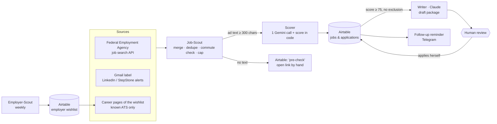

# Jobsuche-Agenten — an agentic workflow for my own job search

A small team of AI-assisted workflows that find jobs, score them by **scope of tasks rather than job title**, prepare application drafts and remind me to follow up. Built with n8n, the free Gemini API tier, Claude and Airtable.

The design rule: **AI suggests, rules check, a human decides.** No workflow applies, sends or publishes anything on its own.

> Status: in progress. Four workflows run on a schedule; the writer step works but is still triggered by hand. See [Roadmap](#roadmap).

---

## What runs today

| Agent | Tool | Schedule | What it does |
| --- | --- | --- | --- |
| **Job-Scout** | n8n | daily, 03:17 | Collects new job ads from three sources, removes duplicates, filters by commute, hands every ad with enough text to the Scorer, sends a short Telegram summary |
| **Scorer** | n8n + Gemini | called by Job-Scout (or a form) | One Gemini call returns part scores and reasons; the **final score is computed in code**, not by the model |
| **Employer-Scout** | n8n + Gemini | Sundays, 05:47 | Builds a wishlist of Berlin employers; every AI suggestion is checked against the real website and imprint before it is saved |
| **Follow-up reminder** | n8n | daily, 08:17 | Telegram reminder 7 days after an application or interview; no AI call |
| **Error alert** | n8n | on failure | Telegram message when any scheduled workflow fails |
| **Writer** | Claude | by hand (daily task planned) | Application package for jobs with score ≥ 75: cover letter as e-mail text, CV tailored to the ad, notes for the application portal |

Runs are scheduled at night or on Sunday morning, outside other people's working hours and away from API peak times.

---

## Architecture



Why the split between n8n and Claude:

- **n8n + free Gemini** handle the repetitive, high-volume steps. Only public ad text and a short profile **without contact data** go to Gemini.
- **Claude** writes everything an employer will read. Full personal data stays there.
- **Airtable** is the single source of truth: one table for jobs and applications, one for the employer wishlist.

Details: [docs/architecture.md](docs/architecture.md)

---

## How a job gets its score

Scope of tasks 50 · skills and tools 20 · language 10 · location and format 10 · conditions 10.

Gemini returns the part scores, penalties, matches, gaps and open questions as JSON. A code node then clamps each part to its range, caps penalties (each at −30, total at −60), adds a bonus for internal roles and computes the final score. Every Airtable record carries the full calculation, so any score can be checked by hand.

Hard exclusions (the Writer is blocked): people management, "5+ years of experience in Germany" as a requirement, and an office outside commuting distance when on-site or hybrid work is required.

Details: [docs/scoring.md](docs/scoring.md)

---

## First real runs (November 2026)

- Federal Employment Agency, one run: 958 hits → 109 after the title pre-filter → 27 dropped as too far without home office → round-robin across 30 search terms → 25 ads scored.
- Gmail alerts: 35 job links extracted from one run.
- Employer-Scout earlier tests: Gemini gave a wrong Berlin address for **7 of 22** companies. Since v1.3 the address is read from each company's imprint page by a rule, and the AI address is only a marked fallback.

What I learned along the way: [docs/lessons-learned.md](docs/lessons-learned.md)

---

## Roadmap

- [x] Employer-Scout with checks against invented companies, addresses and links
- [x] Job-Scout with three sources and a commute rule
- [x] Scorer with deterministic final score
- [x] Follow-up reminder and error alerts via Telegram
- [x] Writer: first application package (by hand, as style reference)
- [ ] Writer as a daily scheduled task, with an employer check (Kununu, Glassdoor, Google reviews → Premium / Solid / Doubtful)
- [ ] Job-Scout v2: no title filter, cheap AI triage by tasks, a weekly "search strategist" that learns new search terms from well-scored jobs
- [ ] ATS check of the CV
- [ ] Weekly review
- [ ] Move n8n from the training provider's instance to my own

---

## Repository layout

```
README.md
docs/
  architecture.md      components, data flow, Airtable tables, schedules
  scoring.md           weights, penalties, exclusions, why the score is computed in code
  lessons-learned.md   real failures and how they were fixed
  privacy.md           what goes to which AI, what never leaves
workflows/             n8n exports with IDs and personal data removed
CHANGELOG.md
```

## What was removed before publishing

Airtable base and table IDs, the Telegram chat ID, the reference point for the commute rule, my candidate profile and my salary expectations. The workflows keep their structure and code; the placeholders are marked `YOUR_…`.

## Licence

MIT, see [LICENSE](LICENSE).
