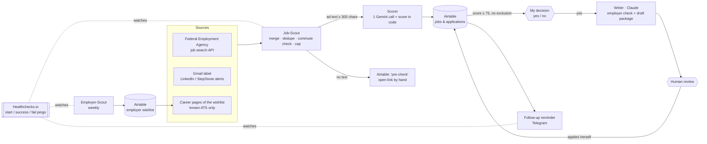

# Jobsuche-Agenten — an agentic workflow for my own job search

A small team of AI-assisted workflows that find jobs, score them by **scope of tasks rather than job title**, prepare application drafts and remind me to follow up. Built with n8n, the free Gemini API tier, Claude and Airtable.

The design rule: **AI suggests, rules check, a human decides.** No workflow applies, sends or publishes anything on its own.

> Status (13 Nov 2026): in progress. Five n8n workflows run on a schedule and are watched from outside (Healthchecks.io, UptimeRobot). The Writer works, including an employer check, and starts only after my explicit "yes" per job; a daily scheduled run is next. See [Roadmap](#roadmap).

---

## What runs today

| Agent | Version | Tool | Schedule | What it does |
| --- | --- | --- | --- | --- |
| **Job-Scout** | v1.6 | n8n | daily, 03:17 | Checks that the server is ready, collects new job ads from three sources, removes duplicates, hands every ad with enough text to the Scorer, sends a short Telegram summary |
| **Scorer** | v1.5 | n8n + Gemini | called by Job-Scout (or a form) | One Gemini call returns part scores and reasons; the **final score is computed in code**, not by the model |
| **Employer-Scout** | v1.3.7 | n8n + Gemini | Sundays, 05:47 | Builds a wishlist of Berlin employers; every AI suggestion is checked against the real website and imprint before it is saved |
| **Follow-up reminder** | v1.3 | n8n | daily, 08:17 | Telegram reminder 7 days after an application or interview; no AI call |
| **Error alert** | v1.1 | n8n | on failure | Telegram message when a scheduled workflow ends with an error; deliberately built without a Code node |
| **Watchdogs** | – | Healthchecks.io, UptimeRobot | every run / every 5 min | Alert by Telegram and e-mail when a run does not start or finish in time, or when the n8n server is down |
| **Writer** | – | Claude | after my "yes" (daily task planned) | Employer check (online reviews → *Premium / Solid middle / Rather not*), then an application package for jobs with score ≥ 75: cover letter as e-mail text, CV tailored to the ad, notes for the application portal |

Runs are scheduled at night or on Sunday morning, outside other people's working hours and away from API peak times.

---

## Architecture



Why the split between n8n and Claude:

- **n8n + free Gemini** handle the repetitive, high-volume steps. Only public ad text and a short profile **without contact data** go to Gemini.
- **Claude** writes everything an employer will read. Full personal data stays there.
- **Airtable** is the single source of truth: one table for jobs and applications, one for the employer wishlist.

Details: [docs/architecture.md](docs/architecture.md)

---

## How a job gets its score

Scope of tasks 50 · skills and tools 20 · language 10 · location and format 10 · conditions 10.

Gemini returns the part scores, penalties, matches, gaps and open questions as JSON. A code node then clamps each part to its range, caps penalties (each at −30, total at −60), adds a bonus for internal roles and computes the final score. Every Airtable record carries the full calculation, so any score can be checked by hand.

Hard exclusions (the Writer is blocked): people management, "5+ years of experience in Germany" as a requirement, work with customers or on the phone as a core duty, a stated salary below my minimum, and an office outside commuting distance when on-site or hybrid work is required.

A missing **must** requirement caps the score at 70, but only when a whole class of tools or knowledge is missing (for example SAP, programming, HGB). Another CRM, another task tracker or another automation tool is only a gap, because I already work with that class of tools.

Details: [docs/scoring.md](docs/scoring.md)

---

## First real runs (November 2026)

- Federal Employment Agency, one run: 958 hits → 109 after the title pre-filter → 27 dropped as too far without home office → round-robin across 30 search terms → 25 ads scored.
- Gmail alerts: 35 job links extracted from one run.
- Employer-Scout earlier tests: Gemini gave a wrong Berlin address for **7 of 22** companies. Since v1.3 the address is read from each company's imprint page by a rule, and the AI address is only a marked fallback.

## The night it failed (12 November 2026)

The 03:17 run stopped after twelve minutes. A Code node could not get a task runner on the n8n server, and the error workflow stayed silent, because it started with a Code node itself. Four jobs were saved and no summary arrived.

The fix was not a longer timeout but removing single points of failure:

- before the run, the workflow asks the server's readiness endpoint up to three times, ten minutes apart, and stops with a Telegram message if the server is not ready;
- every Code node retries up to five times; the node that failed is now an Edit Fields node that needs no runner;
- the error workflow builds its message without a Code node;
- every run pings Healthchecks.io at start and end. If the success ping does not arrive in time, Healthchecks alerts me by Telegram and e-mail, also for runs that crash or are cancelled, which n8n's error workflow does not cover;
- UptimeRobot checks the server every five minutes.

What I learned along the way: [docs/lessons-learned.md](docs/lessons-learned.md)

---

## Roadmap

- [x] Employer-Scout with checks against invented companies, addresses and links
- [x] Job-Scout with three sources and a commute rule
- [x] Scorer with deterministic final score
- [x] Follow-up reminder and error alerts via Telegram
- [x] Watchdogs: readiness check, retries, Healthchecks.io, UptimeRobot
- [x] Writer: first application package (by hand, as style reference), employer check (Kununu, Glassdoor, Google reviews → Premium / Solid middle / Rather not)
- [ ] Writer as a daily scheduled task after my decision in Airtable
- [ ] Job-Scout v1.7 / Scorer v1.6: "check address" flag instead of a distance exclusion, overflow queue instead of dropping jobs over the nightly limit, one company = one application
- [ ] Job-Scout v2: no title filter, cheap AI triage by tasks, a weekly "search strategist" that learns new search terms from well-scored jobs
- [ ] ATS check of the CV
- [ ] Weekly review
- [ ] Move n8n from the training provider's instance to my own server (VPS) before February 2027

---

## Repository layout

```
README.md
docs/
  architecture.md      components, data flow, Airtable tables, schedules
  scoring.md           weights, penalties, exclusions, why the score is computed in code
  lessons-learned.md   real failures and how they were fixed
  privacy.md           what goes to which AI, what never leaves
workflows/             n8n exports with IDs and personal data removed
CHANGELOG.md
```

## What was removed before publishing

Airtable base and table IDs, the Telegram chat ID, the Healthchecks ping addresses, the n8n host, the reference point for the commute rule, my candidate profile, my availability date and my salary expectations. The workflows keep their structure and code; the placeholders are marked `YOUR_…`.

## Licence

MIT, see [LICENSE](LICENSE).
